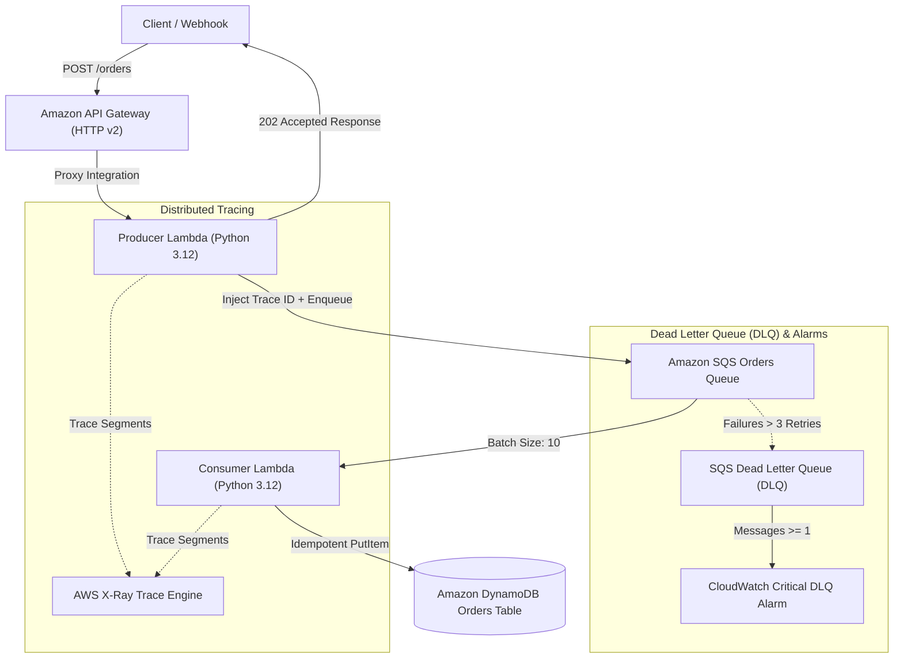

# Enterprise AWS Serverless Event-Driven Architecture with Terraform & Distributed Tracing

[](#-event-driven-architecture)
[](https://www.terraform.io/)
[](https://aws.amazon.com/lambda/)
[](https://aws.amazon.com/sqs/)
[](https://aws.amazon.com/dynamodb/)
[](https://aws.amazon.com/xray/)

A high-performance, asynchronous, serverless transaction processing platform built on **AWS Lambda (Python 3.12)**, **Amazon API Gateway v2**, **Amazon SQS** with automated **Dead Letter Queue (DLQ)** retry handling, and **Amazon DynamoDB**, fully provisioned with **Terraform** and instrumented with **AWS X-Ray** distributed tracing.

---

## 🏛️ Event-Driven Architecture



---

## 🚀 Key Architectural Highlights

1. **Non-Blocking Ingestion:** Clients receive immediate `202 Accepted` confirmation (< 30ms latency) while heavy processing occurs asynchronously.
2. **Resilient Failure Isolation (DLQ):** Messages that fail 3 consecutive attempts are quarantined in an SQS Dead Letter Queue with a 14-day retention window for offline inspection, triggering an automated CloudWatch alarm.
3. **Partial Batch Failure Handling (`ReportBatchItemFailures`):** Employs SQS partial batch responses so only genuinely failed records are retried, preventing unnecessary re-processing of successful records.
4. **Idempotent Storage:** Uses DynamoDB conditional writes (`attribute_not_exists(order_id)`) to ensure exactly-once database semantics despite at-least-once message delivery.
5. **Distributed Tracing (AWS X-Ray):** Active tracing passes context from API Gateway through SQS down to DynamoDB writes for complete latency observability.

---

## 📁 Repository Structure

```text
├── .github/
│   └── workflows/
│       └── serverless-ci.yaml   # Unit testing, Bandit SAST security audit, Terraform validation
├── src/
│   ├── producer.py              # API Gateway -> SQS Producer Lambda with validation
│   └── consumer.py              # SQS -> DynamoDB Consumer with partial batch failure handling
├── events/
│   └── sample_order_event.json  # Sample API Gateway event payload
├── terraform/
│   ├── versions.tf              # AWS provider ~> 5.40 and Archive provider
│   ├── variables.tf             # Configurable parameters
│   ├── dynamodb.tf              # DynamoDB table with PITR and encryption
│   ├── sqs.tf                   # Primary SQS queue, DLQ, and redrive policies
│   ├── iam.tf                   # Least-privilege IAM roles and policies
│   ├── lambda.tf                # Lambda functions with X-Ray tracing and SQS event mapping
│   ├── api_gateway.tf           # HTTP API Gateway v2, routes, and CORS configuration
│   ├── alarms.tf                # CloudWatch alarms for DLQ depth and Lambda errors
│   ├── outputs.tf               # Public endpoints, queue URLs, and table ARNs
│   └── terraform.tfvars.example # Example variable definitions
├── tests/
│   └── test_lambdas.py          # Pytest unit tests verifying validation and error handling
└── docs/
    ├── architecture.md          # Event-driven pattern specifications and tracing breakdown
    └── deployment-guide.md      # AWS deployment, curl testing, and cleanup guide
```

---

## ⚡ Local Testing

```bash
# Install dependencies
pip install -r requirements.txt

# Run automated tests
pytest tests/ -v
```

---

## ☁️ Cloud Deployment via Terraform

```bash
cd terraform

# 1. Initialize providers
terraform init

# 2. Plan and apply
terraform plan -out=tfplan
terraform apply tfplan
```

### Submit a Test Order:
```bash
curl -X POST https://<API_ENDPOINT>/orders \
  -H "Content-Type: application/json" \
  -d '{"customer_id": "cust_123", "amount": 99.50, "currency": "USD"}'
```

---

## 📄 License
This project is open-source under the [MIT License](LICENSE).
