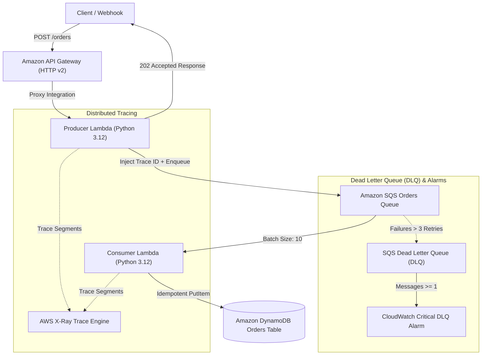

# Serverless Event-Driven Architecture & Distributed Tracing

This document details the asynchronous message processing flow, Dead Letter Queue (DLQ) mechanics, and AWS X-Ray distributed tracing.

---

## 1. Asynchronous Event Flow

---

## 2. Key Reliability Patterns

1. **Decoupled Asynchronous Processing:** The client receives an immediate `202 Accepted` response within ~30ms, protecting user-facing endpoints from downstream database contention.
2. **Exponential Backoff & Failure Isolation:** SQS automatically retries transient failures. Poison-pill messages that fail 3 times are sequestered into the DLQ without blocking other records.
3. **Partial Batch Failure Reporting (`ReportBatchItemFailures`):** If 1 message out of 10 in a batch fails, only that single message is retried by SQS—preventing duplicate processing of the 9 successful messages.
4. **Idempotent Storage:** The consumer uses DynamoDB `attribute_not_exists(order_id)` condition expressions to ensure at-least-once message delivery never creates duplicate orders.
